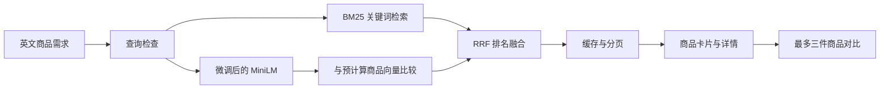

# 系统结构

MiniMatch 的使用入口是搜索、商品详情与商品对比。训练和评估独立于查询请求执行。

- `catalog_search.py`：当前商品库、编码器懒加载、排名、有限查询缓存、分页与详情。
- `release.py`：从已经锁定的微调选择注册应用清单，校验模型、索引与商品库。
- `dense.py`：掩码均值池化、L2 归一化、稳定 top-k 与 RRF。
- `features.py`：BM25、经典排序特征；经典模型主要作为离线参照。
- `dense_v2.py`、`dense_v6.py`：多正例损失、负例掩码及当前验证和早停规则。
- `app.py` 与 `web/`：FastAPI、搜索页面、详情和浏览器本地选择状态。

当前应用从 `models/application/manifest.json` 读取固定模型位置。内部目录名保留用于追溯，用户界面统一显示“微调后的 MiniLM”。搜索请求不读取训练日志或测试标签。

三种搜索方式使用同一商品库。关键词模式只返回有词项命中的商品；语义模式按向量相似度找候选；智能模式融合两种排名。页面只展示原始数据中的商品字段，不生成价格、库存、图片或购买链接。

缓存最多保留 32 个查询与搜索方式组合的排名。分页继续读取同一排序结果，减少重复推理并避免分页重复。商品 ID 用于确定相同分数的排序。

最近搜索和比较选择保存在当前浏览器的 localStorage。页面的外部请求只有本地 API；首次数据或模型准备才会访问对应上游下载地址。
